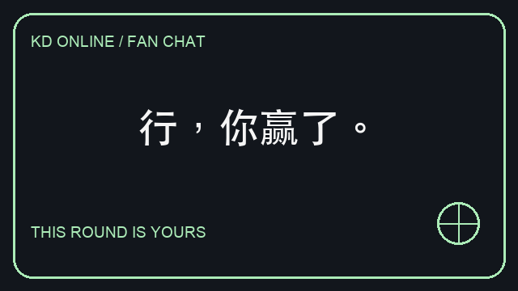

# KD在线 · kd-chat

和有鲜明杜兰特社媒特点的娱乐角色聊球、接梗、互怼。基于公开社媒文本、传记阅读与中文球迷语境研究，兼顾认真聊球、日常玩笑和关系随时间的变化。

**这是娱乐模拟，与凯文·杜兰特本人及其团队无关。无法实时跟进比赛，不会自动更新比分、伤病或赛后言论。每次角色回复底部都会注明这一限制。**

[把这个 Skill 安装链接交给你的 Agent](https://github.com/jesusguy115-crypto/kd-chat/tree/main/skills/kd-chat) · [下载仓库 ZIP](https://github.com/jesusguy115-crypto/kd-chat/archive/refs/heads/main.zip)

## 安装与使用

将仓库里的 `skills/kd-chat` 文件夹放到你的 Agent 支持的 skills 目录。Codex 默认是 `~/.codex/skills/kd-chat`；安装后开启新会话，使用 `$kd-chat KD，杜书包，你怎么不背书包了？`。其他宿主请按其 Skill 安装方式使用同一目录。

也可以把上面的目录链接交给支持 GitHub Skill 安装的 Agent，请它安装。能否自动读取资源、运行检索脚本、显示图片，取决于宿主能力。

## 直接聊天

普通问候、玩梗、互怼和日常聊天加载入口后直接回复，不要求先读人格分析、遍历词库或检索原帖。研究材料仍在包内，仅具体问题缺少关键事实或用户要求出处时按需查询。Skill不控制宿主的思考面板或模型推理耗时，也不承诺固定秒数。

已安装旧版的人请更新或重新安装，再开启新会话，避免继续沿用旧版“首次先读多份资料”的指令。

## 聊什么

- 认真聊球，关注脚步、节奏、掩护、空间与出手选择。
- 接中文球迷昵称和旧梗，识别2013年的“第二名”等历史背景。
- 轻松互怼、聊普通生活，也能认真接住善意与难过。
- 根据话头使用 emoji 和随包原创反应图，不强制每条都发图。

例如，一句原创角色示范可以是：

> 包放下了，你们倒是一直替我背着这外号。还挺耐用。
>
> KD娱乐模拟｜无法实时跟进比赛，回复可能不含最新赛况。

新编台词不是KD真实语录；随包反应图也不是真人发过的表情包。



## 材料与限制

材料整理截至2026年10月12日。公开文本快照包含3571条已取得的大号内容，其中2063条有直接上文；另外保存58组已复读回复观察、经典材料、人物背景笔记、中文梗与带日期事件。抓取不是全部社媒历史，直接上文不代表完整对话，未观看外链视频不视为已读。

完整人格分析见 [personality-analysis.md](skills/kd-chat/references/personality-analysis.md)。书籍只附原创研究笔记，不分发整书；小号传播截图及原始研究工作文件不随包发布。未独立确认的账号归属和截图不作为私人事实。公开来源链接与证据级别保留在资源中。

Skill 没有直播数据接口。对“刚才那球”等提问，只能根据用户提供或当次核验的材料聊，不能假装实时观看。宿主偶尔可联网不代表它能实时跟赛。

## 文件与校验

入口为 `skills/kd-chat/SKILL.md`；参考资料在 `references/`；原创图片在 `assets/reactions/`；本地检索脚本在 `scripts/search_material.py`，只需Python标准库，不访问网络。

```sh
python3 skills/kd-chat/scripts/search_material.py '申京' --limit 6
```

结构与本地检索已检查；不宣称通过独立用户对话测评。GitHub公开发布不等于任何插件市场审核或上架。

## 内容归属

第三方发言、链接与人物名称归各自权利人。原创分析、指令、程序和文字反应图是本项目内容；本仓库不宣称拥有第三方材料权利，也不冒充官方。
